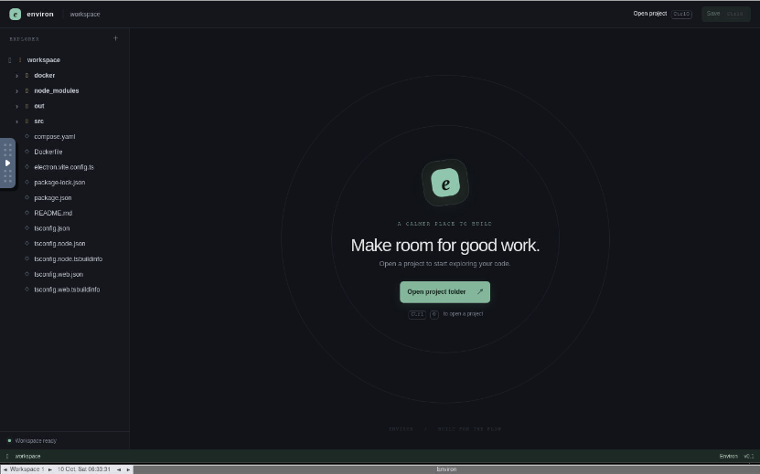

# Environ

Environ is a focused, Rust-native desktop code editor inspired by the familiar workbench pattern of VS Code. It is an independent implementation with its own UI, logo, and workspace services; it does not copy VS Code source or branding.



## Features

- Rust-native desktop runtime built with `eframe`/`egui`.
- Environ logo in the window, workbench, welcome screen, and about dialog.
- Workspace explorer with lazy directory loading, folders-first sorting, and hidden-file support.
- Multiple editor tabs with dirty-state indicators and Save / Save All commands.
- Find and replace across the active document.
- Command palette with keyboard-driven actions.
- Workspace-scoped file access with canonical-path containment checks, symlink escape rejection, UTF-8 validation, binary detection, and a 2 MB text-file limit.
- Optimistic save protection: a file changed by another process is not silently overwritten.
- Temporary-file saves with flush-before-replace behavior.
- GitHub Actions validation for formatting, tests, Clippy, and tagged Windows/Linux/macOS release builds.

## Requirements

- Rust stable toolchain.
- Windows, macOS, or Linux desktop support for `eframe`.
- On Windows local builds, the MSVC linker and Windows SDK are required. The GitHub release workflow provides hosted Windows builds if the local linker is unavailable.

## Development

```sh
cargo fmt --all -- --check
cargo test --all-targets
cargo clippy --all-targets --all-features -- -D warnings
cargo run
```

The release binary is built with:

```sh
cargo build --release
```

The Windows executable is written to `target/release/environ.exe`.

## Keyboard shortcuts

| Shortcut | Action |
| --- | --- |
| `Ctrl/Cmd+O` | Open a project folder |
| `Ctrl/Cmd+S` | Save the active file |
| `Ctrl/Cmd+Shift+S` | Save all files |
| `Ctrl/Cmd+F` | Find and replace |
| `Ctrl/Cmd+Shift+P` | Open the command palette |
| `Escape` | Close transient dialogs |

## Release a Windows `.exe`

Update the version in `Cargo.toml`, commit the change, and push a matching tag:

```sh
git tag v0.2.0
git push origin main --tags
```

The tagged workflow builds and publishes:

- `Environ-vX.Y.Z-windows-x64.exe`
- `Environ-vX.Y.Z-windows-x64.zip`
- Linux x64 and macOS arm64 archives
- `SHA256SUMS`

The release job fails if the tag and Cargo package version differ.

## Project layout

```text
.
├── assets/environ.svg       # Environ brand mark
├── src/main.rs              # Native application and workspace service
├── Cargo.toml               # Rust package metadata and dependencies
├── Cargo.lock               # Reproducible dependency resolution
└── .github/workflows/       # CI and release automation
```

## Security notes

File operations are restricted to the selected workspace. Every directory listing, open, and save re-canonicalizes the path and rejects paths outside the workspace, including symlinked paths. Saves also compare the on-disk file with the version originally opened, preventing an accidental overwrite after an external edit.

## License

The repository is distributed under the MIT License. See the repository history and release metadata for attribution details.
